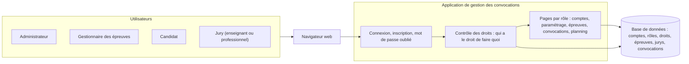
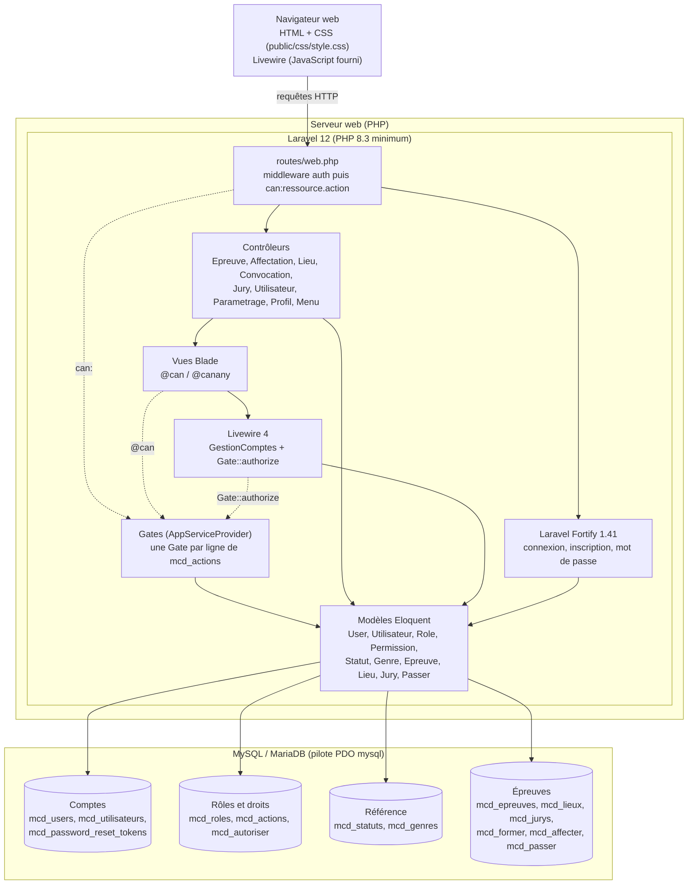

# Architecture de l'application

Ce document présente l'architecture de l'application de gestion des
convocations aux épreuves E5/E6 du BTS SIO, en deux vues :

1. un **schéma fonctionnel**, compréhensible sans connaissances techniques ;
2. un **schéma technique**, qui reprend les mêmes blocs avec les détails
   de mise en œuvre.

---

## 1. Schéma fonctionnel (vue générale)

**Rôle de chaque bloc :**

- **Utilisateurs** : les quatre profils de l'application. L'administrateur
  gère les comptes et les listes de référence ; le gestionnaire organise
  les épreuves et affecte les jurys ; le candidat consulte sa convocation ;
  le jury (enseignant ou professionnel) consulte son planning et les
  candidats qu'il doit évaluer.
- **Navigateur web** : l'application s'utilise depuis un simple navigateur,
  sans rien installer.
- **Connexion, inscription, mot de passe oublié** : la porte d'entrée.
  Seul un compte actif peut se connecter ; un candidat qui s'inscrit doit
  être validé par l'administrateur.
- **Contrôle des droits** : avant chaque page ou chaque action, l'application
  vérifie que le rôle de la personne connectée a le droit de la faire. Ces
  droits sont enregistrés dans la base de données : on peut les modifier
  sans changer le programme.
- **Pages par rôle** : chaque personne ne voit que les menus et les pages
  correspondant à ses droits.
- **Base de données** : elle conserve toutes les informations (comptes,
  rôles, droits, épreuves, lieux, jurys, convocations).

---

## 2. Schéma technique (mise en œuvre)

### Explication des éléments techniques

**Navigateur**

- Pages HTML générées par le serveur, avec une seule feuille de style
  (`public/css/style.css`). Pas de framework CSS ni de compilation
  JavaScript : le code reste simple à lire et à maintenir.
- Le JavaScript de Livewire est fourni automatiquement par le paquet
  Livewire ; il sert uniquement à la page « Gestion des comptes ».

**Serveur web**

- Il exécute PHP et transmet chaque requête à Laravel
  (`public/index.php`). En développement : `php artisan serve`.

**Laravel 12 (PHP 8.3 minimum)**

Framework PHP choisi pour son organisation MVC (Modèle, Vue, Contrôleur),
sa documentation en ligne et ses outils intégrés (authentification,
autorisations, validation des formulaires).

- **`routes/web.php`** : la liste de toutes les pages. Chaque page protégée
  passe par deux contrôles, dans cet ordre :
  1. `middleware('auth')` : un visiteur non connecté est redirigé vers
     `/login` ;
  2. `middleware('can:ressource.action')` : le rôle de l'utilisateur doit
     avoir l'action correspondante, sinon erreur 403.

  `/menu` et `/profil` n'ont que `auth` : elles sont ouvertes à tout
  utilisateur connecté.
- **Laravel Fortify 1.41** : paquet officiel de Laravel qui fournit les
  routes et la logique de connexion, d'inscription, de mot de passe oublié
  et de changement de mot de passe. Le projet fournit ses propres vues et
  ses règles (seul un compte au statut Actif peut se connecter ;
  l'inscription crée un Candidat inactif).
- **Gates (`app/Providers/AppServiceProvider.php`)** : au démarrage,
  l'application lit la table `mcd_actions` et crée une « Gate » Laravel
  (une règle nommée qui répond oui / non) pour chaque action, par exemple
  `epreuves.create`. La Gate appelle `User::hasPermission()`, qui délègue à
  `Utilisateur::hasPermission()` : le rôle de l'utilisateur possède-t-il
  cette action dans `mcd_autoriser` ? Si la base est inaccessible ou si la
  table n'existe pas encore, un avertissement est écrit dans
  `storage/logs/laravel.log` et aucune Gate n'est créée : les commandes
  `php artisan` et `composer install` continuent de fonctionner, et les
  pages protégées répondent 403.
- **Contrôleurs** (`app/Http/Controllers`) : un contrôleur par
  fonctionnalité. Ils ne testent plus les rôles eux-mêmes (c'est le rôle
  du middleware `can:`), mais gardent les règles métier, par exemple :
  l'administrateur ne peut ni se bannir ni retirer son propre rôle
  administrateur.
- **Livewire 4 (`app/Livewire/GestionComptes.php`)** : page « Gestion des
  comptes » (recherche, filtre, boutons Activer / Désactiver / Bannir,
  changement de rôle) sans rechargement de la page. Chaque clic est une
  nouvelle requête qui ne repasse pas par le middleware de la route : le
  composant revérifie donc les droits avec `Gate::authorize()` dans
  `mount()` et au début de chaque action.
- **Vues Blade** (`resources/views`) : les menus, les cartes de l'accueil
  et les boutons sont affichés avec `@can('action')` (ou `@canany` pour un
  menu déroulant). Ce n'est que de l'affichage : la protection réelle reste
  le middleware `can:`.
- **Modèles Eloquent** (`app/Models`) : une classe par table du MCD.
  Points particuliers :
  - `User` (table `mcd_users`) est le compte de connexion ; `Utilisateur`
    (`mcd_utilisateurs`) est la fiche métier, avec le même id (clé
    partagée) et le rôle (`id_role`) ;
  - `Permission` correspond à la table `mcd_actions` ;
    `Role::permissions()` et `Permission::roles()` sont des relations
    `belongsToMany` via la table pivot `mcd_autoriser` (clés `id_role` et
    `id_action`).

**Base de données MySQL / MariaDB**

- Accès par le pilote PDO `mysql` de Laravel. Toutes les tables ont le
  préfixe `mcd_`, écrit directement dans le nom de table de chaque modèle.
- La structure ne vient **pas** des migrations Laravel (`php artisan
  migrate` n'est jamais utilisé) mais de scripts SQL fournis séparément,
  hors du dépôt : `create_v1.sql.txt` (tables issues du MCD, plus
  `mcd_actions` et `mcd_autoriser`), puis les données de référence, le jeu
  de test et la table de réinitialisation des mots de passe. Pour une base
  déjà existante, le script `ajout_autorisations.sql` ajoute les deux
  tables des droits ; il peut être rejoué sans risque.
- **Tables des droits :**
  - `mcd_actions` : 13 actions nommées au format Laravel
    `ressource.action` (`utilisateurs.viewAny`, `epreuves.create`,
    `convocations.view`…) ;
  - `mcd_autoriser` : le lien rôle ↔ action (clé primaire composée
    `id_role, id_action`).

**Matrice des droits** (contenu de `mcd_autoriser`) :

| Action | ADMIN | GEST | CAND | JURY_ENS | JURY_PRO |
|---|:-:|:-:|:-:|:-:|:-:|
| utilisateurs.viewAny, utilisateurs.create, utilisateurs.update | ✔ | | | | |
| parametrage.viewAny, parametrage.create | ✔ | | | | |
| epreuves.viewAny, epreuves.create, epreuves.update | | ✔ | | | |
| lieux.create, convocations.viewAny | | ✔ | | | |
| convocations.view | | | ✔ | | |
| planning.viewAny, evaluations.viewAny | | | | ✔ | ✔ |

**Sécurité**

- Mots de passe hachés (bcrypt) dans `mcd_users` ; jamais stockés en clair
  par l'application.
- Jeton CSRF sur tous les formulaires (`@csrf`), contrôlé par Laravel.
- Connexion limitée à 5 essais par minute (même e-mail et même adresse IP).
- Droits vérifiés côté serveur (middleware `can:` et `Gate::authorize`),
  pas seulement en masquant des liens.
